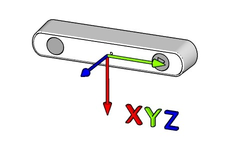

<h1 align="center">
  Open Capture Camera API
</h1>

<h4 align="center">A platform-agnostic camera and sensor capture API for the <a href="https://www.stereolabs.com/products/zed-2">ZED 2, ZED 2i, and ZED Mini</a> stereo cameras</h4>
<h5 align="center">*** not compatible with GMSL2 devices: <a href="https://www.stereolabs.com/products/zed-x">ZED X, ZED X Mini, and ZED X One</a> ***</h5>

<p align="center">
  <a href="#key-features">Key Features</a> •
  <a href="#build-and-install">Build and install</a> •
  <a href="#run">Run</a> • 
  <a href="#documentation">Documentation</a> •
  <a href="#running-the-examples">Examples</a> •
  <a href="#performance">Performance</a> •
  <a href="#known-issues">Known issues</a> •
  <a href="#related">Related</a> •
  <a href="#license">License</a>
</p>
<br>

## Key Features

* Open source C++ capture library, built with the C++17 standard
* No ZED SDK and no NVIDIA GPU required: it works on any Linux computer, including Raspberry Pi 4
* Video Capture
  * raw YUV 4:2:2 data format
  * Camera controls
  * Camera selection by device or by serial number
  * HIGH-RESOLUTION mode with USB3
  * compatibility VGA mode with USB2
* Sensor Data Capture
  * 6-DOF IMU (3-DOF accelerometer + 3-DOF gyroscope), without losing samples
  * 3-DOF Magnetometer (Only ZED 2 and ZED 2i)
  * Barometer (Only ZED 2 and ZED 2i)
  * Sensors temperature (Only ZED 2 and ZED 2i)
* Frames and sensor data on the same clock, with hardware Sensors/video Synchronization
* Portable
  * Tested on Linux
  * Tested on x64, ARM (NVIDIA Jetson AGX Thor, Raspberry Pi 4)
* Small Size
  * ~200KB library size
  * hidapi is the only dependency (sensors module)
* Complete set of examples
  * Video capture
  * Camera control
  * Stereo rectification
  * IMU, magnetometer, and barometer data capture
  * Video and sensor synchronization
  * Disparity/Depth/Point Cloud extraction on CPU using OpenCV
  * Depth tuning using OpenCV control GUI
  * Benchmark of image, sensors and depth performance

## Description

The ZED Open Capture is a multi-platform, open-source C++ library for low-level camera and sensor capture for the ZED stereo camera family. It doesn't require CUDA and therefore can be used on many desktop and embedded platforms.

The open-source library provides methods to access raw video frames, calibration data, camera controls, and raw data from the USB3 camera sensors (on ZED 2, ZED 2i, and ZED Mini). A synchronization mechanism is provided to get the correct sensor data associated with a video frame.

**Note:** While in the ZED SDK all output data is calibrated and compensated, here the extracted raw data is not corrected by the camera and sensor calibration parameters. You can retrieve camera and sensor calibration data using the [ZED SDK](https://www.stereolabs.com/docs/video/camera-calibration/) to correct your camera data [see `zed_open_capture_rectify_example` example](#running-the-examples).

## Build and install

### Prerequisites

* USB3 Stereolabs Stereo camera: [ZED 2i](https://www.stereolabs.com/zed-2i/), [ZED 2](https://www.stereolabs.com/zed-2/), [ZED](https://www.stereolabs.com/zed/), [ZED Mini](https://www.stereolabs.com/zed-mini/)
* Linux OS
* GCC (v7.5+)
* CMake (v3.16+)
* OpenCV (v3.4.0+) -Optional for the examples-
* GoogleTest -Optional for the hardware tests-

### Install prerequisites

* Install GCC compiler and build tools

    `sudo apt install build-essential`

* Install CMake build system

    `sudo apt install cmake`

* Install the HIDAPI library (required by the sensors module):

    `sudo apt install libhidapi-libusb0 libhidapi-dev`

* Install OpenCV to build the examples (optional)

    `sudo apt install libopencv-dev libopencv-viz-dev`

* Install GoogleTest to build the hardware tests (optional)

    `sudo apt install libgtest-dev`

### Clone the repository

```bash
git clone https://github.com/stereolabs/zed-open-capture.git
cd zed-open-capture
```

### Add udev rule

Stereo cameras such as ZED 2 and ZED Mini have built-in sensors (e.g. IMU) that are identified as USB HID devices.
To be able to access the USB HID device, you must add a udev rule contained in the `udev` folder:

```bash
bash udev/install_udev_rule.sh
```

### Build

#### Build library and examples

```bash
mkdir build
cd build
cmake ..
make -j$(nproc)
```

#### Build only the library

```bash
mkdir build
cd build
cmake .. -DBUILD_EXAMPLES=OFF
make -j$(nproc)
```

#### Build only the video capture library

```bash
mkdir build
cd build
cmake .. -DBUILD_SENSORS=OFF -DBUILD_EXAMPLES=OFF
make -j$(nproc)
```

#### Build only the sensor capture library

```bash
mkdir build
cd build
cmake .. -DBUILD_VIDEO=OFF -DBUILD_EXAMPLES=OFF
make -j$(nproc)
```

#### Build options

| Option | Default | Description |
|---|---|---|
| `BUILD_VIDEO` | `ON` | Build the video capture module |
| `BUILD_SENSORS` | `ON` | Build the sensor capture module |
| `BUILD_EXAMPLES` | `ON` | Build the examples (requires OpenCV) |
| `BUILD_TESTS` | `OFF` | Build the hardware tests (requires GoogleTest) |
| `DEBUG_CAM_REG` | `OFF` | Add the functions that log the camera registers |
| `ZED_OC_SANITIZER` | empty | Build with a sanitizer: `address` (with undefined behavior checks) or `thread` |
| `ZED_OC_WARNINGS_AS_ERRORS` | `OFF` | Treat compiler warnings as errors |

The default build type is `Release`. Use `-DCMAKE_BUILD_TYPE=Debug` for a debug build.

### Install

To install the library, go to the `build` folder and launch the following commands:

```bash
sudo make install
sudo ldconfig
```

### Use the library in your application

After the installation the library is available as a CMake package:

```cmake
find_package(zed_open_capture REQUIRED)
target_link_libraries(my_application PRIVATE zed_open_capture::zed_open_capture)
```

A pkg-config file is also installed: `pkg-config --cflags --libs zed_open_capture`.

## Run

### Get video data

Include the `videocapture.hpp` header, declare a `VideoCapture` object, and retrieve a video frame (in YUV 4:2:2 format) with `getLastFrame()`:

```C++
#include "videocapture.hpp"

sl_oc::video::VideoCapture cap;
if( !cap.initializeVideo() ) // first available camera
    return EXIT_FAILURE;

uint64_t last_ts = 0;
while( cap.isOpened() )
{
    const sl_oc::video::Frame& frame = cap.getLastFrame();
    if( frame.data!=nullptr && frame.timestamp!=last_ts ) // a new frame is available
    {
        last_ts = frame.timestamp;
        // frame.data contains two images side by side, frame.width x frame.height pixels
    }
}
```

The returned frame stays valid and unchanged until the next call of `getLastFrame()`.

To select a camera when more than one is connected:

```C++
for( const sl_oc::video::VideoDevice& dev : sl_oc::video::VideoCapture::getDeviceList() )
    std::cout << dev.dev_name << " - serial number: " << dev.serial_number << std::endl;

cap.initializeVideoBySerialNumber( 12345678 ); // or cap.initializeVideo( dev.dev_id )
```

### Get sensor data

Include the `SensorCapture` header, declare a `SensorCapture` object, get a list of available devices, initialize the first one, and finally retrieve sensor data:

```C++
#include "sensorcapture.hpp"

sl_oc::sensors::SensorCapture sens;
std::vector<int> devs = sens.getDeviceList();
sens.initializeSensors( devs[0] );

// All the IMU samples received after the previous call (400 Hz, 800 Hz for ZED Mini): no sample is lost
const std::vector<sl_oc::sensors::data::Imu> imuQueue = sens.getIMUData(5000);

// Only the most recent data
const sl_oc::sensors::data::Imu& imuData = sens.getLastIMUData(5000);
const sl_oc::sensors::data::Magnetometer& magData = sens.getLastMagnetometerData(100);
const sl_oc::sensors::data::Environment& envData = sens.getLastEnvironmentData(100);
const sl_oc::sensors::data::Temperature& tempData = sens.getLastCameraTemperatureData(100);
```

### Timestamps and synchronization

Frames and sensor data use the same clock: the system time read when the first timestamp is needed, then advanced with the monotonic clock, so that the timestamps never go backwards. The clock of the sensors module of the camera is continuously aligned to it.

For the best alignment enable the hardware synchronization: the camera signals each frame to the sensors module, and the frame takes the timestamp of the IMU sample acquired with that signal (the sample with `sync` set to `true`).

```C++
videoCap.initializeVideo();
sensCap.initializeSensors( videoCap.getSerialNumber() );
videoCap.enableSensorSync( &sensCap );
```

## Running the tests

The tests check the library on real hardware: they need at least one camera connected and they do not need a display.
Each test runs on every connected camera.

```bash
mkdir build
cd build
cmake .. -DBUILD_TESTS=ON
make -j$(nproc)
ctest --output-on-failure
```

| Test | What it checks |
|---|---|
| `test_video` | Frame rate and frame integrity in every video mode, camera controls, camera selection, open/close without leaks |
| `test_sensors` | IMU rate, lost samples and timestamps, magnetometer, barometer and temperature data, robustness of the connection |
| `test_sync` | Agreement of video and IMU timestamps when the synchronization is enabled, closing order of the two objects |

A camera connected in USB 2.0 mode is reported as a failure and most of its tests are skipped.

Each test is a GoogleTest executable, so a single case can be selected:

```bash
tests/test_video --gtest_list_tests
tests/test_video --gtest_filter='*Controls*'
```

To look for memory errors or data races, build the tests with a sanitizer:

```bash
cmake .. -DBUILD_TESTS=ON -DBUILD_EXAMPLES=OFF -DZED_OC_SANITIZER=thread -DCMAKE_BUILD_TYPE=RelWithDebInfo
```

## Running the examples

After installing the library and examples, you will have the following sample applications in your `build` directory:

* [zed_open_capture_video_example](https://github.com/stereolabs/zed-open-capture/blob/master/examples/zed_oc_video_example.cpp): This application captures and displays video frames from the camera.
* [zed_open_capture_multicam_video_example](https://github.com/stereolabs/zed-open-capture/blob/master/examples/zed_oc_multi_video_example.cpp): This application captures and displays video frames from two cameras.
* [zed_open_capture_control_example](https://github.com/stereolabs/zed-open-capture/blob/master/examples/zed_oc_control_example.cpp): This application captures and displays video frames from the camera and provides runtime control of camera parameters using keyboard shortcuts.
* [zed_open_capture_rectify_example](https://github.com/stereolabs/zed-open-capture/blob/master/examples/zed_oc_rectify_example.cpp): This application downloads factory stereo calibration parameters from Stereolabs server, performs stereo image rectification and displays original and rectified frames.
* [zed_open_capture_sensors_example](https://github.com/stereolabs/zed-open-capture/blob/master/examples/zed_oc_sensors_example.cpp): This application creates a `SensorCapture` object and displays on the command console the values of camera sensors acquired at full rate.
* [zed_open_capture_sync_example](https://github.com/stereolabs/zed-open-capture/blob/master/examples/zed_oc_sync_example.cpp): This application creates a `VideoCapture` and a `SensorCapture` object, initialize the camera/sensors synchronization and displays on screen the video stream with the synchronized IMU data.
* [zed_open_capture_depth_example](https://github.com/stereolabs/zed-open-capture/blob/master/examples/zed_oc_depth_example.cpp): This application captures video frames, extracts the depth map and the point cloud using only the CPU, and displays the result with the processing time. See [Depth settings](#depth-settings).
* [zed_open_capture_depth_tune_stereo](https://github.com/stereolabs/zed-open-capture/blob/master/examples/tools/zed_oc_tune_stereo_sgbm.cpp): This application captures the first available stereo frames and provides GUI Controls to tune the disparity map results and save them to be used in the `zed_open_capture_depth_example` example
* [zed_open_capture_benchmark](https://github.com/stereolabs/zed-open-capture/blob/master/examples/tools/zed_oc_benchmark.cpp): This application measures the performance of image, sensors and depth acquisition on your computer. It does not need a display.

To run the examples, open a terminal console and enter one of the following commands:

```bash
zed_open_capture_video_example
zed_open_capture_multicam_video_example
zed_open_capture_control_example
zed_open_capture_rectify_example
zed_open_capture_sensors_example
zed_open_capture_sync_example
zed_open_capture_depth_example
zed_open_capture_depth_tune_stereo
zed_open_capture_benchmark
```

**Note:** OpenCV is used in the examples for controls, display, and depth extraction.

## Performance

Performance measured on a **Raspberry Pi 4** (Model B, 8 GB, Raspberry Pi OS 13 64 bit, OpenCV 4.10) with a ZED 2 on a USB 3.0 port, with the tool `zed_open_capture_benchmark`. The desktop was running, with a remote desktop application that used about one CPU core. The complete results, also for NVIDIA Jetson AGX Thor, are in the [benchmarks page](./doc/api_doc/benchmarks.md) of the documentation.

### Image retrieval

| Resolution | Requested FPS | Received FPS | Lost frames | Frame period 1% / 99% [ms] | Latency [ms] | CPU | Memory [MB] | Open [s] |
|---|---|---|---|---|---|---|---|---|
| HD2K (4416x1242) | 15 | 13.4 | 11.3% | 66.09 / 198.85 | 59.9 | 10% | 120 | 0.26 |
| HD1080 (3840x1080) | 30 | 25.0 | 16.1% | 33.24 / 100.49 | 39.1 | 18% | 102 | 0.25 |
| HD720 (2560x720) | 60 | 55.2 | 8.0% | 16.48 / 50.00 | 16.8 | 16% | 72 | 0.22 |
| HD720 (2560x720) | 30 | 28.3 | 5.7% | 33.15 / 100.02 | 31.0 | 8% | 72 | 0.20 |
| VGA (1344x376) | 100 | 98.3 | 1.6% | 9.86 / 20.03 | 6.6 | 9% | 61 | 0.19 |
| VGA (1344x376) | 30 | 30.0 | 0.0% | 33.28 / 33.54 | 20.0 | 3% | 61 | 0.19 |

At VGA resolution all the frames are received. At higher resolutions the USB host of the Raspberry Pi 4 loses part of the data sent by the camera and the incomplete frames are discarded: the same happens reading the camera with `v4l2-ctl`, without the library. *Latency* is the time from the start of the frame to its availability; *CPU* is 100% for one core fully used.

### Sensors retrieval

| Video stream | IMU rate [Hz] | Lost samples | Period [ms] | Period 1% / 99% [ms] | Latency [ms] | Mag. [Hz] | Env. [Hz] | Synced frames | CPU |
|---|---|---|---|---|---|---|---|---|---|
| none | 396.3 | 2 | 2.522 | 2.246 / 2.798 | 0.77 | 49.4 | 24.8 | - | 10% |
| HD2K @ 15 FPS | 395.7 | 8 | 2.522 | 2.248 / 2.837 | 0.89 | 49.3 | 24.7 | 98% | 21% |
| HD1080 @ 30 FPS | 394.7 | 19 | 2.522 | 2.246 / 2.962 | 0.94 | 48.9 | 23.9 | 99% | 29% |
| HD720 @ 60 FPS | 394.1 | 24 | 2.522 | 2.246 / 2.995 | 0.89 | 48.6 | 24.6 | 99% | 29% |
| HD720 @ 30 FPS | 395.8 | 7 | 2.522 | 2.246 / 2.837 | 0.81 | 49.3 | 24.6 | 99% | 19% |
| VGA @ 100 FPS | 396.0 | 5 | 2.522 | 2.286 / 2.837 | 0.81 | 49.6 | 24.8 | 100% | 20% |
| VGA @ 30 FPS | 396.3 | 2 | 2.522 | 2.286 / 2.837 | 0.80 | 49.5 | 24.7 | 99% | 12% |

The IMU is received at full rate with every video mode (the ZED 2 provides 396 samples per second). *Synced frames* are the frames that received the timestamp of the IMU sample acquired with their hardware sync signal.

### Depth generation

| Resolution | Depth map | Convert [ms] | Rectify [ms] | Matching [ms] | Depth [ms] | Total [ms] | Depth FPS | Valid pixels | CPU | Refine [ms] |
|---|---|---|---|---|---|---|---|---|---|---|
| HD2K @ 15 FPS | 2208x1242 | 12.3 | 54.3 | 4767.2 | 17.8 | 4851.6 | 0.2 | 16% | 218% | 441 |
| HD2K @ 15 FPS | 1104x621 | 12.4 | 13.4 | 1040.6 | 5.4 | 1071.8 | 0.9 | 18% | 213% | 202 |
| HD1080 @ 30 FPS | 1920x1080 | 8.0 | 38.5 | 3499.2 | 12.6 | 3558.3 | 0.3 | 22% | 225% | 396 |
| HD1080 @ 30 FPS | 960x540 | 11.0 | 9.3 | 782.2 | 4.0 | 806.4 | 1.2 | 34% | 209% | 215 |
| HD720 @ 30 FPS | 1280x720 | 3.4 | 17.6 | 1458.2 | 7.7 | 1486.8 | 0.7 | 27% | 221% | 237 |
| HD720 @ 30 FPS | 640x360 | 4.7 | 6.3 | 292.9 | 1.7 | 305.6 | 3.3 | 25% | 209% | 144 |
| VGA @ 30 FPS | 672x376 | 0.9 | 7.1 | 302.0 | 1.8 | 311.8 | 3.2 | 40% | 229% | 152 |
| VGA @ 30 FPS | 336x188 | 1.5 | 2.7 | 35.8 | 0.5 | 40.7 | 24.1 | 48% | 208% | 104 |

For each resolution the first row is the depth map at full size (`matchScale` 1.0) and the second row at half size (`matchScale` 0.5, the default). On a Raspberry Pi 4 use the VGA resolution with the default settings to get the depth map in real time (more than 20 FPS), or a 640x360 depth map at about 3 FPS when more detail is required.

### Other values

| | Raspberry Pi 4 | Jetson AGX Thor |
|---|---|---|
| Time to open a camera | 0.2 - 0.3 s | 0.2 s |
| Memory used grabbing frames, VGA / HD2K | 61 MB / 120 MB | 22 MB / 81 MB |
| IMU latency (acquisition to application) | 0.8 - 0.9 ms | 0.4 - 0.5 ms |
| Distance between frame timestamp and hardware sync signal, without synchronization | 0.7 ms (median), 5 ms (99%) | 1 ms (median), 2 ms (99%) |
| Build time of library, examples and tests | about 2 minutes | not measured |
| Depth map 640x360 from HD720 | 3.3 FPS | 22 FPS (30 FPS with `taskset`, see the benchmarks page) |

Run `zed_open_capture_benchmark` to get the same tables for your computer:

```bash
zed_open_capture_benchmark                 # all the measures
zed_open_capture_benchmark --depth         # only the selected measures: --video, --sensors, --depth
zed_open_capture_benchmark --duration 20   # seconds for each measure, default 5
```

## Depth settings

The depth example and the benchmark use the Semi-Global Block Matching algorithm of OpenCV on the CPU. The parameters are stored in `~/zed/settings/zed_oc_stereo.yaml`, created at the first start of `zed_open_capture_depth_example` and modified by `zed_open_capture_depth_tune_stereo`. The default values have been selected comparing the results on indoor scenes with a ZED Mini and a ZED 2: compared to the previous values the pixels with a wrong depth are less than half (from 15% to 5% in the most difficult scene) and the noise of the depth of a static scene is 2 to 3 times lower.

| Parameter | Default | Effect |
|---|---|---|
| `matchScale` | 0.5 | Size of the depth map relative to the camera image. 1.0 gives more detail but it is 4 to 8 times slower |
| `numDisparities` | 96 | Disparity range in pixels of the depth map. A higher value measures closer objects (minimum distance = focal x baseline / numDisparities) and it is proportionally slower |
| `blockSize` | 5 | Size of the matched block. Higher values give a smoother and more dense depth map with less detail |
| `mode` | 2 | 2 (`MODE_SGBM_3WAY`) is the fastest. 1 (`MODE_HH`) reduces the wrong values (up to 35% less in our tests) but it is about 6 times slower |
| `disp12MaxDiff` | 1 | Left-right consistency check. Disabling it (-1) gives a more dense depth map with more wrong values |
| `uniquenessRatio` | 5 | Higher values remove uncertain matches |
| `speckleWindowSize`, `speckleRange` | 255, 1 | Removal of small isolated regions |
| `refineRectification` | 1 | Measures and corrects the vertical misalignment of the two images while running. A camera can show a misalignment of a few pixels after a shock or far from the calibration temperature |
| `medianSize` | 0 | Median filter of the disparity map: 0 (disabled), 3 or 5 |
| `minDepth_mm`, `maxDepth_mm` | 300, 10000 | Range of the valid depth values |

## Documentation

The API is documented in the Include.h files. It is also generated as a Doxygen for simpler navigation: https://stereolabs.github.io/zed-open-capture

You can also generate the documentation locally in HTML format (with Doxygen) using the commands below. Access the docs by opening `doc/html/index.html` in your web browser.

```bash
sudo apt-get install -y doxygen # if not previously installed
cd doc
./generate_doc.sh
```

## Coordinates system

The coordinate system is only used for sensor data. The given IMU and Magnetometer data are expressed in the RAW coordinate system as shown below



## Known issues

### USB 2.0 connection

A camera connected to a USB 2.0 port, or with a USB 2.0 cable, only provides a few low resolution modes at a reduced frame rate. In this case `initializeVideo()` fails for the other resolutions and the error message reports the USB 2.0 connection. `VideoCapture::getDeviceList()` and `zed_open_capture_benchmark` show the speed of the connection of each camera.

### Lost frames on Raspberry Pi 4

On a Raspberry Pi 4 part of the frames are lost at resolutions higher than VGA, because the USB host cannot always receive all the data sent by the camera (see [Performance](#performance)). Lost frames can be detected from the gaps of `Frame::frame_id` or of the frame timestamps. Use the VGA resolution, or HD720 at 30 FPS, when all the frames are required.

### OpenGL version

On some embedded devices, like Raspberry Pi 4, the depth extraction example can crash with the following error:

`vtkShaderProgram.cxx:438    ERR| vtkShaderProgram (0x23a611c0): 0:1(10): error: GLSL 1.50 is not supported. Supported versions are: 1.10, 1.20, 1.00 ES, and 3.00 ES`

to correctly execute the example application it is necessary to change the default OpenGL version:

```bash
export MESA_GL_VERSION_OVERRIDE=3.2
```

you can permanently add this configuration by adding the above command as the last line of the `~/.bashrc` file.

## Related

* [Stereolabs](https://www.stereolabs.com)
* [ZED 2i multi-sensor camera](https://www.stereolabs.com/zed-2i/)
* [ZED SDK](https://www.stereolabs.com/developers/)

## License

This library is licensed under the MIT License.

## Support

If you need assistance go to our Community site at https://community.stereolabs.com/

