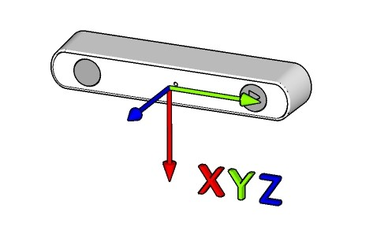

# ZED Open Capture API

The ZED Open Capture library allows the low level control of ZED 2i, ZED 2, ZED Mini and ZED cameras on Linux computers, without the ZED SDK and without an NVIDIA GPU. The library provides methods to access raw video frames, to control the video parameters and to acquire raw data from the internal sensors (only ZED Mini, ZED 2, and ZED 2i). Frames and sensors data share the same clock, and a synchronization mechanism based on a hardware signal is provided to get the correct sensor data associated to each video frame.

**Note:** The provided data are not calibrated, images are not rectified in a stereoscopic way, IMU data may drift or be misaligned.
Calibration data can be accessed using the [ZED SDK](https://docs.stereolabs.com/docs/development/zed-sdk).

## Coordinates system

The coordinate system is only used for sensors data (especially for IMU). The given IMU data are expressed in the RAW/IMU coordinate system as show below

## Installation

### Prerequisites

 * A Stereolabs USB 3 camera: ZED 2i, ZED 2, ZED Mini or ZED (see the [ZED USB 3 cameras](https://docs.stereolabs.com/docs/products/cameras/zed) documentation)
 * Linux OS [Tested on Ubuntu 22.04 (x86_64), Ubuntu 24.04 (NVIDIA Jetson AGX Thor) and Raspberry Pi OS 13 (Raspberry Pi 4)]
 * GCC compiler [at least v7.5]
 * CMake build system [at least v3.16]
 * HIDAPI library for the USB communication with the sensors
 * OpenCV [at least v3.4. Required only by examples]
 * GoogleTest [Required only by the hardware tests]
 * git [if installing from source]

#### Install prerequisites

* Install GCC compiler and build tools

    `$ sudo apt install build-essential`

* Install CMake build system

    `$ sudo apt install cmake`

* Install the HIDAPI library:

    `$ sudo apt install libhidapi-libusb0 libhidapi-dev`

* Install OpenCV to compile the examples

    `$ sudo apt install libopencv-dev`

### Clone the repository

    $ git clone https://github.com/stereolabs/zed-open-capture.git
    $ cd zed-open-capture

### Install the udev rule
To be able to access the sensors without root privileges you must install the udev rule contained in the `udev` folder:

    $ bash udev/install_udev_rule.sh

### Compile

#### Compile library and examples

    $ mkdir build
    $ cd build
    $ cmake ..
    $ make -j$(nproc)

#### Compile only the library

    $ mkdir build
    $ cd build
    $ cmake .. -DBUILD_EXAMPLES=OFF 
    $ make -j$(nproc)

#### Compile only the video library with the video examples

    $ mkdir build
    $ cd build
    $ cmake .. -DBUILD_SENSORS=OFF
    $ make -j$(nproc)

#### Compile only the video library

    $ mkdir build
    $ cd build
    $ cmake .. -DBUILD_SENSORS=OFF -DBUILD_EXAMPLES=OFF
    $ make -j$(nproc)

#### Compile only the sensors library with the sensors example
    
    $ mkdir build
    $ cd build
    $ cmake .. -DBUILD_VIDEO=OFF
    $ make -j$(nproc)

#### Compile only the sensors library
    
    $ mkdir build
    $ cd build
    $ cmake .. -DBUILD_VIDEO=OFF -DBUILD_EXAMPLES=OFF
    $ make -j$(nproc)
    
### Install

After compiling it is possible to install the library and the examples.
From inside the `build` folder:

    $ sudo make install
    $ sudo ldconfig

### Use the library in a CMake project

After the installation the library is available as a CMake package:

    find_package(zed_open_capture REQUIRED)
    target_link_libraries(my_application PRIVATE zed_open_capture::zed_open_capture)

A pkg-config file is also installed: `pkg-config --cflags --libs zed_open_capture`.

## Performance

See \ref benchmarks for the frame rates, the sensors rates and the depth processing time measured on Raspberry Pi 4
and NVIDIA Jetson AGX Thor.

## Local documentation

Documentation can be locally generated in HTML format using Doxygen:

    $ sudo apt-get install -y doxygen # if not previously installed
    $ cd doc
    $ ./generate_doc.sh
    
The local documentation will be available opening the file `doc/html/index.html` with a standard web browser.

